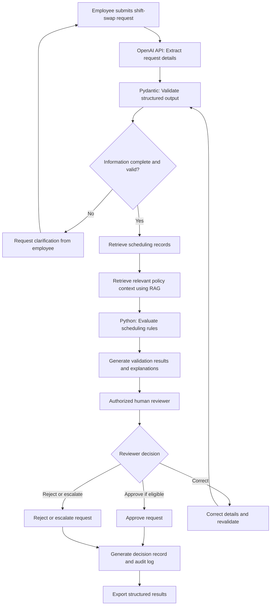

# Yes Engine: AI-Assisted Shift-Swap Validation and Approval System

**Springboard AI for Programmers. Week 7 Final Project**

**Project Option 2**: Comprehensive AI Project Proposal

**Project Status**: Proposed Architecture and Implementation Plan

Technology Focus: Python, OpenAI API, Structured Outputs, Retrieval-Augmented Generation (RAG), Human-in-the-Loop (HITL), and AI Observability

-------------------------------------------------------------

## 1. Project Overview
The Yes Engine is a proposed AI-assisted system for validating and approving shift swaps, designed to simplify employee scheduling requests, maintain operational compliance, reduce administrative workload, and preserve human oversight.

The project builds on an earlier workflow automation initiative I explored in my professional environment, where I investigated using Microsoft Forms, Excel, and Power Automate to streamline employee shift exchanges.

The original concept relied primarily on structured form submissions, spreadsheet calculations, and predefined business rules. While this approach showed how automation could reduce repetitive administrative tasks, it also revealed opportunities to introduce more flexible and intelligent interactions.

The proposed Yes Engine builds on this concept by incorporating Large Language Models (LLMs), Python-based validation, structured outputs, and human-in-the-loop approval checkpoints.

Rather than requiring employees to fill out multiple form fields, the proposed system would allow users to submit natural-language requests, such as:
"Can I swap my Friday closing shift with another team member who works earlier that day?"

The AI would interpret the request, identify the required scheduling information, and convert it into a structured format. A deterministic validation engine would then evaluate the proposed exchange against the applicable scheduling constraints.

Before finalizing any schedule modification, the system would present its findings to an authorized reviewer for approval, correction, or rejection.

The objective is not to replace Workforce Management professionals but to provide an intelligent decision-support tool that reduces manual verification and improves the consistency, transparency, and efficiency of shift-swap processing.

-------------------------------------------------------------

## 2. Problem Statement

Employee shift exchanges can require multiple administrative steps, including verifying employee schedules, confirming agreement between team members, calculating working hours, reviewing scheduling policies, and determining whether a proposed exchange is operationally acceptable.

When these checks are performed manually, the process can become repetitive, time-consuming, and prone to inconsistencies.

Traditional workflow automation can address some of these challenges through structured forms and deterministic business rules. However, these workflows may struggle with incomplete submissions, conversational requests, policy explanations, and unusual scheduling scenarios.

The Yes Engine proposes an AI-assisted approach that combines flexible natural-language processing with reliable rule-based validation.

The system would address four primary challenges:
1.	**Manual administrative workload**: Reduce repetitive data collection and preliminary scheduling verification.
2.	**Unstructured employee requests**: Translate conversational requests into consistent, machine-readable information.
3.	**Scheduling compliance**: Evaluate requests against documented constraints using deterministic Python logic rather than relying on AI-generated assumptions.
4.	**Decision transparency**: Provide clear validation results and explanations while keeping final scheduling decisions under human control.

-------------------------------------------------------------

## 3. Project Objectives

The proposed system is designed to achieve the following objectives:
- Simplify employee shift-swap requests through natural-language interactions.
- Extract employee names, shift dates, times, and swap details into structured JSON objects.
- Retrieve relevant scheduling policies and supporting documentation when necessary.
- Validate scheduling constraints using Python-based calculations and predefined business rules.
- Identify missing information, scheduling conflicts, and requests requiring additional review.
- Implement human-in-the-loop checkpoints before approving or executing schedule modifications.
- Generate standardized decisions and structured records suitable for spreadsheet-based workflows.
- Establish evaluation metrics and observability practices to monitor reliability, consistency, and potential policy violations.

-------------------------------------------------------------

## 4. Project Scope and Assumptions

This project is a comprehensive technical proposal rather than a deployed software application.

The proposed implementation will use fictional employee identities, simulated schedules, and illustrative scheduling rules to demonstrate the intended system behavior.

Any references to existing enterprise tools or Workforce Management platforms indicate potential integration opportunities rather than confirmed technical connections.

Actual deployment would require authorized access to scheduling systems, formal policy verification, security reviews, and approval from the relevant operational stakeholders.

The design prioritizes reliability, maintainability, transparency, and responsible AI use over unfettered automation.

-------------------------------------------------------------

**Disclaimer: No live employee scheduling data, confidential company policies, or production system credentials are included in this public repository.**

-------------------------------------------------------------

## 5. Target Users and Stakeholders

The Yes Engine is designed to support three primary user groups in an employee scheduling environment.

-------------------------------------------------------------

### 5.1 Employees

Employees would use the system to submit shift-swap requests via natural language or a structured form.

The proposed interface would allow employees to:

- Request single-day or full-week shift exchanges.
- Identify the coworker involved in the exchange.
- Confirm that both employees have agreed to the proposed swap.
- Provide missing information when prompted.
- Receive updates regarding the status of their request.

-------------------------------------------------------------

### 5.2 Team Leaders and Authorized Reviewers

Team leaders or designated scheduling reviewers would review proposed changes before final approval.

Their responsibilities would include:

- Reviewing AI-extracted scheduling information.
- Examining validation results and potential policy conflicts.
- Approving, correcting, rejecting, or escalating requests according to their authorization.
- Providing feedback when the system produces incomplete or inaccurate recommendations.

-------------------------------------------------------------

### 5.3 Workforce Management (WFM)

Workforce Management professionals would provide domain expertise and help establish policies governing shift exchanges.

Their responsibilities in the proposed implementation would include:

- Reviewing and validating scheduling rules.
- Defining acceptable working-hour limits and required rest periods.
- Identifying additional restrictions related to staffing and coverage.
- Reviewing exceptions and escalated requests.
- Evaluating whether the system's proposed decisions align with operational requirements.

The team would establish final approval authority through an agreed operational policy before deployment.

-------------------------------------------------------------

## 6. Proposed Core Workflow

The Yes Engine would use a sequential workflow combining AI-assisted information extraction, deterministic scheduling checks, and human approval.

-------------------------------------------------------------

### Step 1: Employee Submits a Request

An employee initiates a shift exchange via a proposed conversational interface or a structured form.

Example request:
"Can I trade my Friday closing shift for Alex's morning shift? We have already agreed to switch shifts."

The system would collect the request without assuming that all necessary details have been included.

-------------------------------------------------------------

### Step 2: AI Extracts Structured Information

An LLM would analyze the employee's request and extract relevant information into a predefined JSON schema.

Potential fields include:

- Requesting employee
- Swap partner
- Requested date or date range
- Original shift
- Proposed replacement shift
- Swap type
- Partner agreement confirmation

Pydantic models would validate the structure of the extracted data.

Missing or ambiguous details would prompt a clarification request rather than an automatic assumption.

-------------------------------------------------------------

### Step 3: Retrieve Scheduling Policies and Data

The proposed system would retrieve relevant scheduling information from authorized sources.

A Retrieval-Augmented Generation (RAG) component could provide contextual information from approved policy documents.

Current shift assignments and working hours would be retrieved separately from the structured scheduling records.

The system would maintain a distinction between retrieved policy guidance and authoritative numerical scheduling data.

-------------------------------------------------------------

### Step 4: Validate the Proposed Exchange

A Python-based validation engine would evaluate the request against the applicable scheduling constraints.

Illustrative checks include:

- Whether both employees are assigned to the relevant shifts.
- Whether the proposed exchange creates overlapping assignments.
- Whether projected weekly working hours exceed the configured limits.
- Whether mandatory rest periods would be violated.
- Whether the exchange satisfies applicable scheduling and coverage requirements.
- Whether the request falls within an authorized submission window.

These checks would use deterministic calculations and explicitly configured business rules rather than relying on the LLM to assess compliance.

A request that fails a mandatory constraint would be flagged or rejected per the approved workflow.

-------------------------------------------------------------

### Step 5: Human-in-the-Loop Review

Before a schedule change is finalized, the system would present the proposed exchange and validation findings to an authorized human reviewer for review.

The reviewer could:

- Approve the proposed change.
- Request additional information.
- Correct inaccurate information.
- Reject a request.
- Escalate an exception for further review.

The system would pause execution until the required human decision is made.

-------------------------------------------------------------

### Step 6: Generate the Final Decision Record

Following review, the Yes Engine would generate a structured record containing:

- The original request
- Extracted scheduling details
- Validation results
- Applicable policy references
- Reviewer decision and any corrections
- Final request status
- Relevant timestamps

The record could be exported to an Excel-compatible format to support operational review and reporting.

Any future integration that alters a production schedule would require separate authorization and additional safeguards.

-------------------------------------------------------------

### Step 7: Capture Feedback for Improvement

Reviewer corrections and identified errors would be compiled as evaluation examples, subject to appropriate data protection controls.

These examples could help improve:

- Prompt accuracy
- Structured data extraction
- Policy retrieval
- Validation coverage
- Exception handling

The system would use this feedback to support controlled testing and future improvements rather than automatically modifying its own business rules.

-------------------------------------------------------------

## 7. Technical Architecture and Implementation Plan

### 7.1 Architecture Overview

The proposed Yes Engine would use a modular, Python-based architecture that separates natural-language interpretation, structured data validation, policy retrieval, scheduling calculations, and human approval.

This separation is intentional. Large Language Models (LLMs) are useful for understanding conversational requests and generating explanations, but they should not independently determine whether an employee's schedule complies with organizational policies.

Instead, the system would integrate AI capabilities with deterministic business logic, authoritative scheduling records, and human oversight.

The proposed workflow is illustrated below.

The diagram depicts a proposed implementation, not an existing production deployment. All scheduling information and policy rules used during initial development would be fictional or illustrative.

-------------------------------------------------------------

### 7.2 Proposed Technology Stack

| Component | Proposed Technology | Purpose |
|---|---|---|
| Programming Language | Python | Implement workflow logic and scheduling calculations |
| AI Processing | OpenAI API | Interpret natural-language requests and extract information |
| Structured Data Validation | Pydantic | Validate data types, required fields, and schema constraints |
| Backend API | FastAPI | Provide application endpoints and coordinate workflow stages |
| Policy Retrieval | Retrieval-Augmented Generation (RAG) | Retrieve relevant passages from approved policy documents |
| Vector Database | Pinecone | Store and search embeddings representing policy documents |
| Scheduling Records | SQLite or CSV files | Maintain fictional employee information and simulated schedules |
| Business Rules Engine | Python functions | Apply deterministic scheduling compliance checks |
| Human Approval | Proposed reviewer interface | Allow authorized individuals to review, correct, approve, or reject requests |
| AI Observability | LangSmith | Capture traces, inspect model behavior, and support evaluations |
| Reporting | JSON and CSV/Excel-compatible exports | Produce structured decision records for operational review |
| Version Control | Git and GitHub | Track implementation changes, documentation, and future project development |

These technologies are proposed implementation options. The initial prototype could use a simpler Python command-line interface and local simulated data before introducing a web application or external integrations.

-------------------------------------------------------------

### 7.3 Natural-Language Processing and Structured Outputs

The first AI component would interpret an employee's request and convert conversational language into structured data.

For example, an employee might write:
"Can I trade my Friday evening shift for Alex's morning shift? We both agreed."

The OpenAI API would identify information such as the requester, the proposed swap partner, the relevant date, and the requested exchange.

A Pydantic model would define the expected schema, including the following fields:

The model would extract only information supported by the request or authorized scheduling records.

The system would verify employee identities and shift assignments against structured records rather than assuming them from the AI response.

A missing date, an ambiguous employee identity, or an unverified agreement would prevent the system from proceeding to final approval.

This component applies the structured-output and prompt-engineering concepts explored in the Springboard program.

-------------------------------------------------------------

### 7.4 Retrieval-Augmented Generation (RAG)

The proposed RAG component would help the system locate relevant policy information without relying solely on the LLM's general knowledge.

The policy retrieval process would involve:

1. Collecting approved, version-controlled scheduling policy documents.
2. Dividing the documents into meaningful text sections.
3. Generating embeddings for those sections.
4. Storing the embeddings and document metadata in Pinecone.
5. Retrieving relevant policy passages when evaluating a specific request.
6. Providing policy references to support explanations and reviewer decisions.

Policy records would include identifying information such as a document title, version, and effective date, when available.

RAG would retrieve supporting context and explain policy requirements. It would not independently create or modify compliance rules.

The deterministic validation engine would enforce only rules confirmed by authorized stakeholders and included in an approved machine-readable configuration.

If an applicable policy is missing, outdated, or contradictory, the request would be flagged for human review rather than automatically deemed compliant.

-------------------------------------------------------------

### 7.5 Deterministic Scheduling Validation

After the request is structured and the necessary scheduling records are retrieved, Python functions would perform the required scheduling calculations.

The proposed validation engine would evaluate illustrative constraints such as:

- Whether each employee is assigned to the shift being exchanged.
- Whether both employees have the qualifications required for the proposed assignments.
- Whether the exchange creates overlapping shifts.
- Whether projected weekly working hours exceed configured limits.
- Whether the exchange violates required rest periods.
- Whether coverage requirements remain satisfied.
- Whether the request meets relevant submission deadlines.
- Whether the swap partner has independently confirmed participation.

Weekly hours would be recalculated using the proposed assignments, accounting for applicable unpaid breaks and other approved scheduling rules.

A rule violation, a missing authoritative record, or an unsupported scheduling scenario would prevent an automatic eligibility recommendation.

Workforce Management stakeholders would need to confirm actual overtime limits, scheduling windows, rest requirements, and other policy thresholds before implementation.

The LLM would not be permitted to override the results of these deterministic checks.

-------------------------------------------------------------

### 7.6 Human-in-the-Loop Approval

Human-in-the-loop (HITL) review would serve as a required control before finalizing a shift exchange.

An authorized reviewer would receive a summary containing:

- The original employee request.
- Extracted employee and scheduling information.
- Current and proposed assignments.
- Scheduling validation results.
- Relevant policy references.
- Missing information and identified conflicts.
- A proposed status or recommendation.

The reviewer could approve an eligible request, reject it, request clarification, correct information, or escalate an exception.

If the reviewer changes employee information, shift assignments, or other details that affect compliance, the system would rerun the applicable validation checks before allowing final approval.

Approval authority and exception-handling responsibilities would need to be formally established prior to production deployment.

This design applies the human-in-the-loop concepts covered in Week 5 of the Springboard program.

-------------------------------------------------------------

### 7.7 Workflow Orchestration and Error Handling

Python would coordinate the individual processing stages in a structured sequence.

Each stage would receive a defined input and produce a validated output before the next stage begins.

The workflow would include safeguards for common failure scenarios:

- **Missing information:** Request clarification before continuing.
- **Invalid JSON or schema mismatch:** Reject the invalid output and attempt controlled recovery.
- **Unknown employee or shift:** Require verification against scheduling records.
- **Unavailable policy documents:** Pause the request and route it for review.
- **Failed scheduling validation:** Present the violation without claiming the exchange is eligible.
- **LLM or retrieval failure:** Record the failure and allow manual processing.
- **Missing reviewer authorization:** Prevent approval or finalization.
- **Changed scheduling information:** Revalidate before accepting the revised request.

The application would also preserve request identifiers and processing statuses to prevent duplicate decisions or accidental repeated actions.

-------------------------------------------------------------

### 7.8 Data Storage, Audit Records, and Integrations

The initial implementation would use fictional employee records, sample policy documents, and simulated shift assignments, all stored locally.

Each processed request would generate a structured audit record that includes relevant input data, validation outcomes, policy references, reviewer actions, timestamps, and final status.

Where appropriate, records could be exported to CSV or Excel-compatible formats to support reporting and review.

Potential future integrations may include Microsoft Forms, Power Automate, Slack, or an authorized Workforce Management platform.

These integrations would require separate technical feasibility assessments, access authorization, privacy protections, and stakeholder approval.

No production scheduling system would be modified under this proposal.

-------------------------------------------------------------

### 7.9 Phased Implementation Plan

The proposed system could be developed in four incremental phases.

**Phase 1 — Core Proof of Concept**

- Create fictional employee schedules and sample shift-swap requests.
- Define Pydantic models for structured extraction.
- Implement natural-language parsing using the OpenAI API.
- Build initial Python scheduling validation functions.

**Phase 2 — Decision Support and Human Review**

- Implement request statuses and validation explanations.
- Add an authorized reviewer checkpoint.
- Support corrections, rejection, escalation, and revalidation.
- Generate standardized decision records and exports.

**Phase 3 — Policy Retrieval and Quality Evaluation**

- Introduce RAG for approved policy documentation.
- Add LangSmith tracing and an evaluation dataset.
- Test extraction accuracy, policy retrieval, and validation reliability.
- Review failure scenarios and refine prompts under version control.

**Phase 4 — Enterprise Integration Assessment**

- Review security and privacy requirements.
- Confirm scheduling policies and approval responsibilities.
- Evaluate integration compatibility with authorized systems.
- Conduct stakeholder testing before considering any production deployment.

This phased approach would enable the project to demonstrate practical AI capabilities while maintaining clear boundaries between experimental features and operational decision-making.

-------------------------------------------------------------
