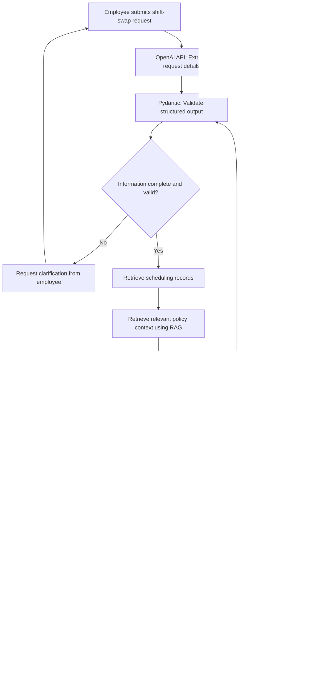

# Yes Engine: AI-Assisted Shift-Swap Validation and Approval System

**Springboard AI for Programmers. Week 7 Final Project**

**Project Option 2**: Comprehensive AI Project Proposal

**Project Status**: Proposed Architecture and Implementation Plan

Technology Focus: Python, OpenAI API, Structured Outputs, Retrieval-Augmented Generation (RAG), Human-in-the-Loop (HITL), and AI Observability

-------------------------------------------------------------

## Table of Contents

1. [Project Overview](#1-project-overview)
2. [Problem Statement](#2-problem-statement)
3. [Project Objectives](#3-project-objectives)
4. [Project Scope and Assumptions](#4-project-scope-and-assumptions)
5. [Target Users and Stakeholders](#5-target-users-and-stakeholders)
6. [Proposed Core Workflow](#6-proposed-core-workflow)
7. [Technical Architecture and Implementation Plan](#7-technical-architecture-and-implementation-plan)
8. [Example Prompts and Expected Structured Outputs](#8-example-prompts-and-expected-structured-outputs)
9. [Evaluation Strategy and Success Metrics](#9-evaluation-strategy-and-success-metrics)
10. [Observability and Monitoring](#10-observability-and-monitoring)
11. [Security, Risks, Limitations, and Guardrails](#11-security-risks-limitations-and-guardrails)
12. [Future Improvements and Conclusion](#12-future-improvements-and-conclusion)

-------------------------------------------------------------

## 1. Project Overview
The Yes Engine is a proposed AI-assisted shift-swap validation and decision-support system designed to simplify employee scheduling requests, maintain operational compliance, reduce administrative workload, and preserve human oversight.

The project builds on an earlier workflow automation initiative I explored in my professional environment, where I investigated using Microsoft Forms, Excel, and Power Automate to streamline employee shift exchanges.

The original concept relied primarily on structured form submissions, spreadsheet calculations, and predefined business rules. While this approach showed how automation could reduce repetitive administrative tasks, it also revealed opportunities to introduce more flexible and intelligent interactions.

The proposed Yes Engine builds on this concept by incorporating Large Language Models (LLMs), Python-based validation, structured outputs, and human-in-the-loop approval checkpoints.

Rather than requiring employees to fill out multiple form fields, the proposed system would allow users to submit natural-language requests, such as:
"Can I swap my Friday closing shift with another team member who works earlier that day?"

The AI would interpret the request, identify the required scheduling information, and convert it into a structured format. A deterministic validation engine would then evaluate the proposed exchange against the applicable scheduling constraints.

Before finalizing any schedule modification, the system would present its findings to an authorized reviewer for approval, correction, or rejection.

The objective is not to replace Workforce Management professionals but to provide an intelligent decision-support tool that reduces manual verification and improves the consistency, transparency, and efficiency of shift-swap processing.

-------------------------------------------------------------

## 2. Problem Statement

Employee shift exchanges can require multiple administrative steps, including verifying employee schedules, confirming agreement between team members, calculating working hours, reviewing scheduling policies, and determining whether a proposed exchange is operationally acceptable.

When these checks are performed manually, the process can become repetitive, time-consuming, and prone to inconsistencies.

Traditional workflow automation can address some of these challenges through structured forms and deterministic business rules. However, these workflows may struggle with incomplete submissions, conversational requests, policy explanations, and unusual scheduling scenarios.

The Yes Engine proposes an AI-assisted approach that combines flexible natural-language processing with reliable rule-based validation.

The system would address four primary challenges:
1.	**Manual administrative workload**: Reduce repetitive data collection and preliminary scheduling verification.
2.	**Unstructured employee requests**: Translate conversational requests into consistent, machine-readable information.
3.	**Scheduling compliance**: Evaluate requests against documented constraints using deterministic Python logic rather than relying on AI-generated assumptions.
4.	**Decision transparency**: Provide clear validation results and explanations while keeping final scheduling decisions under human control.

-------------------------------------------------------------

## 3. Project Objectives

The proposed system is designed to achieve the following objectives:
- Simplify employee shift-swap requests through natural-language interactions.
- Extract employee names, shift dates, times, and swap details into structured JSON objects.
- Retrieve relevant scheduling policies and supporting documentation when necessary.
- Validate scheduling constraints using Python-based calculations and predefined business rules.
- Identify missing information, scheduling conflicts, and requests requiring additional review.
- Implement human-in-the-loop checkpoints before approving or executing schedule modifications.
- Generate standardized decisions and structured records suitable for spreadsheet-based workflows.
- Establish evaluation metrics and observability practices to monitor reliability, consistency, and potential policy violations.

-------------------------------------------------------------

## 4. Project Scope and Assumptions

This project is a comprehensive technical proposal rather than a deployed software application.

The proposed implementation will use fictional employee identities, simulated schedules, and illustrative scheduling rules to demonstrate the intended system behavior.

Any references to existing enterprise tools or Workforce Management platforms indicate potential integration opportunities rather than confirmed technical connections.

Actual deployment would require authorized access to scheduling systems, formal policy verification, security reviews, and approval from the relevant operational stakeholders.

The design prioritizes reliability, maintainability, transparency, and responsible AI use over unfettered automation.

-------------------------------------------------------------

**Disclaimer: No live employee scheduling data, confidential company policies, or production system credentials are included in this public repository.**

-------------------------------------------------------------

## 5. Target Users and Stakeholders

The Yes Engine is designed to support three primary user groups in an employee scheduling environment.

-------------------------------------------------------------

### 5.1 Employees

Employees would use the system to submit shift-swap requests via natural language or a structured form.

The proposed interface would allow employees to:

- Request single-day or full-week shift exchanges.
- Identify the coworker involved in the exchange.
- Confirm that both employees have agreed to the proposed swap.
- Provide missing information when prompted.
- Receive updates regarding the status of their request.

The system would require independent confirmation from the swap partner before forwarding the request for final approval.

-------------------------------------------------------------

### 5.2 Team Leaders and Authorized Reviewers

Team leaders or designated scheduling reviewers would review proposed changes before final approval.

Their responsibilities would include:

- Reviewing AI-extracted scheduling information.
- Examining validation results and potential policy conflicts.
- Approving, correcting, rejecting, or escalating requests according to their authorization.
- Providing feedback when the system produces incomplete or inaccurate recommendations.

-------------------------------------------------------------

### 5.3 Workforce Management (WFM)

Workforce Management professionals would provide domain expertise and help establish policies governing shift exchanges.

Their responsibilities in the proposed implementation would include:

- Reviewing and validating scheduling rules.
- Defining acceptable working-hour limits and required rest periods.
- Identifying additional restrictions related to staffing and coverage.
- Reviewing exceptions and escalated requests.
- Evaluating whether the system's proposed decisions align with operational requirements.

The team would establish final approval authority through an agreed operational policy before deployment.

-------------------------------------------------------------

## 6. Proposed Core Workflow

The Yes Engine would use a sequential workflow combining AI-assisted information extraction, deterministic scheduling checks, and human approval.

-------------------------------------------------------------

### Step 1: Employee Submits a Request

An employee initiates a shift exchange via a proposed conversational interface or a structured form.

Example request:
"Can I trade my Friday closing shift for Alex's morning shift? We have already agreed to switch shifts."

The system would collect the request without assuming that all necessary details have been included.

-------------------------------------------------------------

### Step 2: AI Extracts Structured Information

An LLM would analyze the employee's request and extract relevant information into a predefined JSON schema.

Potential fields include:

- Requesting employee
- Swap partner
- Requested date or date range
- Original shift
- Proposed replacement shift
- Swap type
- Partner agreement confirmation

Pydantic models would validate the structure of the extracted data.

Missing or ambiguous details would prompt a clarification request rather than an automatic assumption.

-------------------------------------------------------------

### Step 3: Retrieve Scheduling Policies and Data

The proposed system would retrieve relevant scheduling information from authorized sources.

A Retrieval-Augmented Generation (RAG) component could provide contextual information from approved policy documents.

Current shift assignments and working hours would be retrieved separately from the structured scheduling records.

The system would maintain a distinction between retrieved policy guidance and authoritative numerical scheduling data.

-------------------------------------------------------------

### Step 4: Validate the Proposed Exchange

A Python-based validation engine would evaluate the request against the applicable scheduling constraints.

Illustrative checks include:

- Whether both employees are assigned to the relevant shifts.
- Whether the proposed exchange creates overlapping assignments.
- Whether projected weekly working hours exceed the configured limits.
- Whether mandatory rest periods would be violated.
- Whether the exchange satisfies applicable scheduling and coverage requirements.
- Whether the request falls within an authorized submission window.

These checks would use deterministic calculations and explicitly configured business rules rather than relying on the LLM to assess compliance.

A request that fails a mandatory constraint would be flagged or rejected per the approved workflow.

-------------------------------------------------------------

### Step 5: Human-in-the-Loop Review

Before a schedule change is finalized, the system would present the proposed exchange and validation findings to an authorized human reviewer for review.

The reviewer could:

- Approve the proposed change.
- Request additional information.
- Correct inaccurate information.
- Reject a request.
- Escalate an exception for further review.

The system would pause execution until the required human decision is made.

If a reviewer modifies employee information, shift assignments, or other details affecting scheduling compliance, the system would rerun the applicable validation checks before allowing final approval.

-------------------------------------------------------------

### Step 6: Generate the Final Decision Record

Following review, the Yes Engine would generate a structured record containing:

- The original request
- Extracted scheduling details
- Validation results
- Applicable policy references
- Reviewer decision and any corrections
- Final request status
- Relevant timestamps

The record could be exported to an Excel-compatible format to support operational review and reporting.

Any future integration that alters a production schedule would require separate authorization and additional safeguards.

-------------------------------------------------------------

### Step 7: Capture Feedback for Improvement

Reviewer corrections and identified errors would be compiled as evaluation examples, subject to appropriate data protection controls.

These examples could help improve:

- Prompt accuracy
- Structured data extraction
- Policy retrieval
- Validation coverage
- Exception handling

The system would use this feedback to support controlled testing and future improvements rather than automatically modifying its own business rules.

-------------------------------------------------------------

## 7. Technical Architecture and Implementation Plan

### 7.1 Architecture Overview

The proposed Yes Engine would use a modular, Python-based architecture that separates natural-language interpretation, structured data validation, policy retrieval, scheduling calculations, and human approval.

This separation is intentional. Large Language Models (LLMs) are useful for understanding conversational requests and generating explanations, but they should not independently determine whether an employee's schedule complies with organizational policies.

Instead, the system would integrate AI capabilities with deterministic business logic, authoritative scheduling records, and human oversight.

The proposed workflow is illustrated below.



The diagram depicts a proposed implementation, not an existing production deployment. All scheduling information and policy rules used during initial development would be fictional or illustrative.

-------------------------------------------------------------

### 7.2 Proposed Technology Stack

| Component | Proposed Technology | Purpose |
|---|---|---|
| Programming Language | Python | Implement workflow logic and scheduling calculations |
| AI Processing | OpenAI API | Interpret natural-language requests and extract information |
| Structured Data Validation | Pydantic | Validate data types, required fields, and schema constraints |
| Backend API | FastAPI | Provide application endpoints and coordinate workflow stages |
| Policy Retrieval | Retrieval-Augmented Generation (RAG) | Retrieve relevant passages from approved policy documents |
| Vector Database | Pinecone | Store and search embeddings representing policy documents |
| Scheduling Records | SQLite or CSV files | Maintain fictional employee information and simulated schedules |
| Business Rules Engine | Python functions | Apply deterministic scheduling compliance checks |
| Human Approval | Proposed reviewer interface | Allow authorized individuals to review, correct, approve, or reject requests |
| AI Observability | LangSmith | Capture traces, inspect model behavior, and support evaluations |
| Reporting | JSON and CSV/Excel-compatible exports | Produce structured decision records for operational review |
| Version Control | Git and GitHub | Track implementation changes, documentation, and future project development |

These technologies are proposed implementation options. The initial prototype could use a simpler Python command-line interface and local simulated data before introducing a web application or external integrations.

-------------------------------------------------------------

### 7.3 Natural-Language Processing and Structured Outputs

The first AI component would interpret an employee's request and convert conversational language into structured data.

For example, an employee might write:
"Can I trade my Friday evening shift for Alex's morning shift? We both agreed."

The OpenAI API would identify information such as the requester, the proposed swap partner, the relevant date, and the requested exchange.

A Pydantic model would define the expected schema, including the following fields:

- Requesting employee identifier
- Swap partner identifier
- Requested date or date range
- Original shift assignment
- Proposed replacement shift
- Swap type: single-day or full-week
- Partner agreement status
- Missing or ambiguous information

The model would extract only information supported by the request or authorized scheduling records.

The system would verify employee identities and shift assignments against structured records rather than assuming them from the AI response.

A missing date, an ambiguous employee identity, or an unverified agreement would prevent the system from proceeding to final approval.

This component applies the structured-output and prompt-engineering concepts explored in the Springboard program.

-------------------------------------------------------------

### 7.4 Retrieval-Augmented Generation (RAG)

The proposed RAG component would help the system locate relevant policy information without relying solely on the LLM's general knowledge.

The policy retrieval process would involve:

1. Collecting approved, version-controlled scheduling policy documents.
2. Dividing the documents into meaningful text sections.
3. Generating embeddings for those sections.
4. Storing the embeddings and document metadata in Pinecone.
5. Retrieving relevant policy passages when evaluating a specific request.
6. Providing policy references to support explanations and reviewer decisions.

Policy records would include identifying information such as a document title, version, and effective date, when available.

RAG would retrieve supporting context and explain policy requirements. It would not independently create or modify compliance rules.

The deterministic validation engine would enforce only rules confirmed by authorized stakeholders and included in an approved machine-readable configuration.

If an applicable policy is missing, outdated, or contradictory, the request would be flagged for human review rather than automatically deemed compliant.

-------------------------------------------------------------

### 7.5 Deterministic Scheduling Validation

After the request is structured and the necessary scheduling records are retrieved, Python functions would perform the required scheduling calculations.

The proposed validation engine would evaluate illustrative constraints such as:

- Whether each employee is assigned to the shift being exchanged.
- Whether both employees have the qualifications required for the proposed assignments.
- Whether the exchange creates overlapping shifts.
- Whether projected weekly working hours exceed configured limits.
- Whether the exchange violates required rest periods.
- Whether coverage requirements remain satisfied.
- Whether the request meets relevant submission deadlines.
- Whether the swap partner has independently confirmed participation.

Weekly hours would be recalculated using the proposed assignments, accounting for applicable unpaid breaks and other approved scheduling rules.

A rule violation, a missing authoritative record, or an unsupported scheduling scenario would prevent an automatic eligibility recommendation.

Workforce Management stakeholders would need to confirm actual overtime limits, scheduling windows, rest requirements, and other policy thresholds before implementation.

The LLM would not be permitted to override the results of these deterministic checks.

-------------------------------------------------------------

### 7.6 Human-in-the-Loop Approval

Human-in-the-loop (HITL) review would serve as a required control before finalizing a shift exchange.

An authorized reviewer would receive a summary containing:

- The original employee request.
- Extracted employee and scheduling information.
- Current and proposed assignments.
- Scheduling validation results.
- Relevant policy references.
- Missing information and identified conflicts.
- A proposed status or recommendation.

The reviewer could approve an eligible request, reject it, request clarification, correct information, or escalate an exception.

If the reviewer changes employee information, shift assignments, or other details that affect compliance, the system would rerun the applicable validation checks before allowing final approval.

Approval authority and exception-handling responsibilities would need to be formally established prior to production deployment.

This design applies the human-in-the-loop concepts covered in Week 5 of the Springboard program.

-------------------------------------------------------------

### 7.7 Workflow Orchestration and Error Handling

Python would coordinate the individual processing stages in a structured sequence.

Each stage would receive a defined input and produce a validated output before the next stage begins.

The workflow would include safeguards for common failure scenarios:

- **Missing information:** Request clarification before continuing.
- **Invalid JSON or schema mismatch:** Reject the invalid output and attempt controlled recovery.
- **Unknown employee or shift:** Require verification against scheduling records.
- **Unavailable policy documents:** Pause the request and route it for review.
- **Failed scheduling validation:** Present the violation without claiming the exchange is eligible.
- **LLM or retrieval failure:** Record the failure and allow manual processing.
- **Missing reviewer authorization:** Prevent approval or finalization.
- **Changed scheduling information:** Revalidate before accepting the revised request.

The application would also preserve request identifiers and processing statuses to prevent duplicate decisions or accidental repeated actions.

-------------------------------------------------------------

### 7.8 Data Storage, Audit Records, and Integrations

The initial implementation would use fictional employee records, sample policy documents, and simulated shift assignments, all stored locally.

Each processed request would generate a structured audit record that includes relevant input data, validation outcomes, policy references, reviewer actions, timestamps, and final status.

Where appropriate, records could be exported to CSV or Excel-compatible formats to support reporting and review.

Potential future integrations may include Microsoft Forms, Power Automate, Slack, or an authorized Workforce Management platform.

These integrations would require separate technical feasibility assessments, access authorization, privacy protections, and stakeholder approval.

No production scheduling system would be modified under this proposal.

-------------------------------------------------------------

### 7.9 Phased Implementation Plan

The proposed system could be developed in four incremental phases.

**Phase 1 — Core Proof of Concept**

- Create fictional employee schedules and sample shift-swap requests.
- Define Pydantic models for structured extraction.
- Implement natural-language parsing using the OpenAI API.
- Build initial Python scheduling validation functions.

**Phase 2 — Decision Support and Human Review**

- Implement request statuses and validation explanations.
- Add an authorized reviewer checkpoint.
- Support corrections, rejection, escalation, and revalidation.
- Generate standardized decision records and exports.

**Phase 3 — Policy Retrieval and Quality Evaluation**

- Introduce RAG for approved policy documentation.
- Add LangSmith tracing and an evaluation dataset.
- Test extraction accuracy, policy retrieval, and validation reliability.
- Review failure scenarios and refine prompts under version control.

**Phase 4 — Enterprise Integration Assessment**

- Review security and privacy requirements.
- Confirm scheduling policies and approval responsibilities.
- Evaluate integration compatibility with authorized systems.
- Conduct stakeholder testing before considering any production deployment.

This phased approach would enable the project to demonstrate practical AI capabilities while maintaining clear boundaries between experimental features and operational decision-making.

-------------------------------------------------------------

## 8. Example Prompts and Expected Structured Outputs

### 8.1 Purpose of the Examples

This section demonstrates how the proposed Yes Engine would process an employee shift-swap request using prompt engineering, structured outputs, and deterministic validation.

Two sample prompts are presented:

1. A natural-language extraction prompt that converts an employee request into structured JSON.
2. A reviewer-facing explanation prompt that summarizes verified scheduling results without changing the underlying compliance decision.

All employee identities, scheduling records, policy references, and validation outcomes in these examples are fictionalized.

These examples illustrate expected system behavior. They are not outputs of an executed or deployed Yes Engine application.

-------------------------------------------------------------

### 8.2 Example 1: Natural-Language Request Extraction

**Scenario**

An employee named Riley Morgan wants to swap a Friday morning shift with Avery Chen, who works later that day.

The employee submits the following request:

> "Hi! I'd like to swap my Friday, November 6, 2026, shift from 9 AM to 5 PM with Avery Chen's shift from noon to 8 PM. We already discussed and agreed to switch shifts."

The application would provide the authenticated requester identifier separately from the employee's message.

**Sample Prompt 1 — Structured Data Extraction**

```text
You are the scheduling request extraction component
for Yes Engine.

Your task is to extract shift-swap information from
an employee's message into a predefined JSON schema.

Rules:
1. Extract only details explicitly provided in the
   employee's message or trusted application context.
2. Do not invent employee identifiers, dates, times,
   or scheduling information.
3. Convert dates and shift times into standardized formats.
4. Distinguish an employee's claim of partner agreement
   from independently verified confirmation.
5. Use null for unknown values.
6. Identify missing or ambiguous information.
7. Do not approve or reject a shift-swap request.
8. Return structured JSON only.

Authenticated requester ID: EMP-001

Employee message:
"Hi! I'd like to swap my Friday, November 6, 2026,
shift from 9 AM to 5 PM with Avery Chen's shift from
noon to 8 PM. We already discussed and agreed to switch shifts."
```

**Expected Structured JSON Output**

```json
{
  "requester_id": "EMP-001",
  "swap_partner_name": "Avery Chen",
  "swap_partner_id": null,
  "requested_shift_date": "2026-11-06",
  "swap_type": "single_day",
  "requester_original_shift": {
    "start_time": "09:00",
    "end_time": "17:00"
  },
  "partner_original_shift": {
    "start_time": "12:00",
    "end_time": "20:00"
  },
  "partner_agreement_claimed": true,
  "missing_information": [],
  "extraction_status": "complete_pending_verification"
}
```

**Explanation**

The expected output shows how the AI converts conversational text into standardized scheduling data.

The requesting employee's identifier comes from trusted application context, not from the LLM guessing it.

The swap partner's identifier remains null until the application verifies Avery Chen's identity against authorized scheduling records.

Likewise, the employee's statement that both parties agreed would not serve as independent confirmation.

Before further processing, the application would verify employee identities, current shift assignments, and the swap partner's participation.

The JSON structure would be validated against a Pydantic schema before being passed to subsequent workflow stages.

-------------------------------------------------------------

### 8.3 Simulated Scheduling Validation

After successful extraction, the application would retrieve the fictional schedule records and apply its deterministic Python validation functions.

For this example, assume the simulated records confirm:

- Riley Morgan and Avery Chen are assigned to the stated shifts.
- Avery Chen has independently confirmed participation.
- Each scheduled shift includes a 30-minute unpaid break.
- Both employees would have 37.5 paid hours during the applicable workweek after the exchange.
- The illustrative weekly-hours limit is 40 hours.
- Neither employee has a conflicting shift or a violation of the configured rest requirements.
- The applicable sample scheduling checks pass.

These assumptions are provided solely to illustrate the proposed validation process and are not actual employer policies or verified production data.

**Simulated Deterministic Validation Output**

```json
{
  "request_id": "SWAP-1001",
  "requester_id": "EMP-001",
  "swap_partner_id": "EMP-002",
  "schedule_records_verified": true,
  "partner_confirmation_verified": true,
  "projected_weekly_paid_hours": {
    "EMP-001": 37.5,
    "EMP-002": 37.5
  },
  "illustrative_weekly_hour_limit": 40,
  "validation_checks": [
    {
      "rule": "shift_assignments",
      "result": "pass"
    },
    {
      "rule": "weekly_hours",
      "result": "pass"
    },
    {
      "rule": "shift_overlap",
      "result": "pass"
    },
    {
      "rule": "minimum_rest",
      "result": "pass"
    },
    {
      "rule": "partner_confirmation",
      "result": "pass"
    }
  ],
  "policy_reference": "sample-shift-swap-policy-v1",
  "eligibility": "eligible_for_review",
  "approved": false
}
```

The proposed Python validation engine would generate these results from authoritative structured records and from configured rules.

The LLM would neither perform the compliance calculations nor independently determine the final eligibility status.

Passing validation means the request is eligible for human review, not that it has received final approval.

-------------------------------------------------------------

### 8.4 Example 2: Reviewer-Facing Explanation

After the deterministic validation stage, the system could use the LLM to generate a readable summary for an authorized reviewer.

The model would be restricted to explaining the provided validation results rather than modifying them.

**Sample Prompt 2 — Decision Explanation**

```text
You are the reviewer explanation component
for Yes Engine.

Generate a concise, factual summary of the supplied
scheduling validation results.

Rules:
1. Use only the provided validation data.
2. Do not invent policy requirements or employee details.
3. Do not override Python validation results.
4. Distinguish eligibility from final approval.
5. Identify any warnings or missing information.
6. Make clear that human authorization is required.
7. Return structured JSON only.

Verified request: SWAP-1001
Requester: Riley Morgan
Swap partner: Avery Chen
Requested date: 2026-11-06
Shift records verified: true
Independent partner confirmation: true
Projected weekly paid hours: 37.5 for each employee
Illustrative weekly-hours limit: 40
Shift overlap check: pass
Minimum rest check: pass
All configured checks: pass
Eligibility: eligible_for_review
Human approval: pending
```

**Expected Reviewer-Facing JSON Output**

```json
{
  "request_id": "SWAP-1001",
  "eligibility": "eligible_for_review",
  "review_status": "pending_human_approval",
  "summary": "The proposed shift exchange between Riley Morgan and Avery Chen passed the supplied scheduling validation checks.",
  "validation_explanation": [
    "Both employees' shift assignments were verified.",
    "Independent confirmation from the swap partner was recorded.",
    "Each employee would have 37.5 paid hours for the applicable workweek.",
    "The proposed exchange passed the configured overlap and rest-period checks."
  ],
  "warnings": [],
  "human_approval_required": true,
  "approved": false,
  "schedule_updated": false
}
```

-------------------------------------------------------------

### 8.5 Handling Incomplete or Ambiguous Requests

Not every shift-swap request would contain enough information for immediate processing.

For example:

> "Can I swap with Alex next Friday?"

This request neither uniquely identifies the swap partner nor specifies the shifts involved.

The proposed system should seek clarification rather than guess.

Depending on the available verified context, it might prompt the employee to confirm the relevant date, identify the correct coworker, and specify the original and proposed shifts.

The request would remain incomplete until the necessary information had been obtained and validated.

The application would not consider an incomplete request eligible for approval.

-------------------------------------------------------------

### 8.6 Expected Benefits of Structured Outputs

These examples illustrate several benefits of combining LLMs with structured schemas and deterministic validation:

- **Consistency:** Shift-swap information follows a standardized data structure.
- **Reduced ambiguity:** Missing details can be identified before processing.
- **Reliability:** Python calculations and approved rules determine compliance.
- **Traceability:** Validation results can be linked to their source records and policy references.
- **Human oversight:** The AI generates decision-support information without authorizing schedule changes.
- **Integration readiness:** Structured records can support future APIs, reporting, and spreadsheet exports.

This design applies the prompt-engineering, structured-output, chaining, and human-in-the-loop principles explored throughout the Springboard AI for Programmers program.

-------------------------------------------------------------

## 9. Evaluation Strategy and Success Metrics

### 9.1 Evaluation Overview

The proposed Yes Engine would require a comprehensive evaluation strategy before it is considered for operational deployment.

The evaluation process would assess the accuracy of AI-generated structured outputs, the reliability of deterministic scheduling validation, the relevance of retrieved policy information, and the effectiveness of human-in-the-loop controls.

Because shift-swap decisions can affect employee schedules, staffing coverage, and policy compliance, evaluation would prioritize reliability and safety over response speed or automation volume.

The proposed evaluation framework builds on the dataset-based testing, LLM evaluation, and LangSmith observability concepts covered in Week 4 of the Springboard AI for Programmers program.

This section outlines a proposed testing methodology and preliminary acceptance criteria. No performance results are claimed because Yes Engine has not yet been implemented or evaluated as a functioning application.

-------------------------------------------------------------

### 9.2 Evaluation Dataset and Ground Truth

The initial evaluation dataset would include fictional employee schedules, synthetic shift-swap requests, and illustrative scheduling policies.

A preliminary dataset could include approximately 60 scenarios, including routine requests and challenging edge cases.

Examples would include:

- Valid single-day shift exchanges.
- Valid full-week shift exchanges.
- Requests with missing dates or shift times.
- Requests involving ambiguous employee names.
- Shift exchanges that exceed configured weekly-hour limits.
- Requests creating overlapping shift assignments.
- Exchanges violating configured minimum rest periods.
- Requests lacking independent partner confirmation.
- Requests involving outdated or conflicting policy references.
- Requests submitted outside an illustrative authorized window.

Approximately 40 scenarios could support initial development and prompt refinement, while 20 separately maintained scenarios could serve as a held-out evaluation set.

The held-out set would remain unchanged throughout prompt development to provide a more meaningful assessment of generalization.

Each scenario would include an expected structured extraction, relevant scheduling data, applicable policy rules, expected validation results, and an expected workflow outcome.

Qualified Workforce Management subject matter experts would be responsible for reviewing and approving the ground-truth examples before any operational deployment.

For the initial proposal, expected outcomes would be based solely on clearly documented fictional rules.

-------------------------------------------------------------

### 9.3 Structured Data Extraction Evaluation

The first evaluation category would measure how accurately the LLM converts natural-language requests into structured JSON format.

The evaluation would compare the extracted fields with the expected values in the test dataset.

Important fields would include:

- Requesting employee identifier.
- Swap partner name or identifier.
- Requested shift date.
- Original and proposed shift times.
- Swap type.
- Claimed partner agreement.
- Missing or ambiguous information.

The evaluation would measure:

**Field-Level Extraction Accuracy**

The percentage of evaluated fields that match their expected values.

Formula:

Field Accuracy = Correctly Extracted Fields / Total Evaluated Fields × 100

**Schema Validation Success Rate**

The percentage of extraction responses that satisfy the required Pydantic schema.

**Missing Information Detection Rate**

The percentage of intentionally incomplete requests correctly identified as requiring clarification.

**Unsupported Information Rate**

The percentage of evaluated outputs that include invented employee identifiers, shift assignments, or other information not supported by the input or trusted context.

The evaluation would distinguish formatting errors from factual extraction errors. A JSON object could be syntactically valid yet contain incorrect scheduling information.

-------------------------------------------------------------

### 9.4 Deterministic Scheduling Validation Evaluation

The Python validation engine would be tested independently of the LLM.

Unit tests would provide predefined scheduling records and compare the engine's results against expected outcomes.

The tests would cover typical scenarios, boundary conditions, and combinations of conflicting constraints.

Examples include:

| Test Scenario | Expected Result |
|---|---|
| Valid swap with verified agreement and all checks passing | Eligible for human review |
| Projected weekly hours exceed the configured limit | Block or flag as ineligible |
| Swap creates overlapping shifts | Block or flag as ineligible |
| Required rest period is violated | Block or flag as ineligible |
| Partner confirmation is missing | Hold pending verification |
| Employee identity cannot be verified | Hold pending clarification |
| Required scheduling records are unavailable | Escalate for manual review |
| A reviewer changes the proposed shift | Revalidate the modified request |

The engine would use approved rule configurations and explicit Python-based calculations.

It would not rely on LLM-generated judgments to determine whether a mandatory scheduling constraint had been met.

The primary safety metric would be the policy violation rate for requests that receive final approval.

**Policy Violation Rate on Approved Requests**

Formula:

Policy Violation Rate = Approved Requests Violating a Mandatory Rule / Total Approved Requests × 100

For a system intended to support scheduling compliance, the proposed acceptance target would be zero known policy violations across approved test requests.

This result would need to be verified against the approved ground-truth cases. A zero-violation result on a limited test set would not prove that the system is free of all possible failures.

If no requests are approved during a test run, this metric would be reported as not applicable rather than as zero.

-------------------------------------------------------------

### 9.5 RAG and Policy Retrieval Evaluation

The proposed RAG component would be evaluated to determine whether it retrieves the correct scheduling policies and provides relevant supporting context.

Test cases would include questions on scheduling constraints, submission requirements, shift eligibility, and policy exceptions.

Key evaluation criteria would include:

**Retrieval Relevance**

Whether the retrieved document passages address the scheduling question under evaluation.

**Policy Version Accuracy**

Whether the system identifies the applicable approved policy version and effective date.

**Citation Accuracy**

Whether the explanation cites the correct supporting document or policy section.

**Unsupported Policy Claims**

Whether the generated explanation introduces requirements that are not present in the retrieved authoritative sources.

**Missing Policy Handling**

Whether the system correctly escalates requests when required policies are missing, outdated, or contradictory.

The evaluation dataset would include expected policy references so retrieval results could be compared with a documented ground truth.

Incorrect retrieval would not automatically authorize a scheduling decision because the deterministic validation engine would continue to rely on separately approved rule configurations.

-------------------------------------------------------------

### 9.6 Human-in-the-Loop Evaluation

The human review stage would be evaluated to ensure that the system does not finalize scheduling changes without the required authorization.

Test cases would verify that:

- Requests remain pending until an authorized reviewer acts.
- Unauthorized users cannot approve requests.
- Mandatory validation failures cannot be silently overridden.
- Reviewer corrections trigger the necessary revalidation.
- Rejected requests are not recorded as approved.
- Approval decisions and relevant timestamps are recorded.
- System errors do not bypass the human approval checkpoint.

The central human-oversight metric would be the percentage of finalized requests with a valid, authorized reviewer decision record.

The proposed target would be 100%.

Any failure that allows an unauthorized or unvalidated schedule change would be classified as a critical defect requiring correction before deployment.

-------------------------------------------------------------

### 9.7 Proposed Evaluation Metrics and Acceptance Targets

The following targets are preliminary design goals, not measured system results.

| Evaluation Metric | Proposed Target | Priority |
|---|---|---|
| Field-level extraction accuracy | At least 95% | High |
| Pydantic schema validation success after controlled processing | 100% for records accepted into the workflow | High |
| Missing information detection | At least 95% | High |
| Unsupported or invented critical scheduling details | 0 accepted without verification | Critical |
| Mandatory-rule violations among approved test requests | 0% | Critical |
| Unauthorized final approvals | 0 | Critical |
| Revalidation after compliance-relevant corrections | 100% | Critical |
| Relevant policy retrieval | At least 90% on the evaluation dataset | High |
| Authorized reviewer decision records for finalized requests | 100% | Critical |

These thresholds would require review and adjustment by technical and operational stakeholders prior to production use.

An evaluation report would include the number of test cases, observed results, error examples, and limitations, rather than presenting target values as achieved performance.

Meeting an aggregate accuracy target would not compensate for failures related to mandatory scheduling constraints or authorization.

-------------------------------------------------------------

### 9.8 Evaluation Workflow and Continuous Improvement

The proposed evaluation process would follow a repeatable sequence:

1. Prepare synthetic evaluation examples and expected outcomes.
2. Validate the ground-truth examples against documented sample rules.
3. Execute AI extraction and policy retrieval tests.
4. Run independent Python scheduling validation tests.
5. Test human approval and exception-handling safeguards.
6. Compare observed outputs with expected results.
7. Record failures, disagreements, and unexpected behavior.
8. Refine prompts, data schemas, or application logic as appropriate.
9. Rerun regression tests following each significant change.
10. Document the final evaluation results and remaining limitations.

LangSmith could organize evaluation datasets, inspect traces, compare prompt versions, and investigate incorrect outputs.

A separate set of deterministic unit tests would continue to verify the Python scheduling calculations and authorization rules.

Human reviewers would examine failures requiring domain expertise, including ambiguous policies or conflicting scheduling requirements.

Reviewer feedback would be incorporated into controlled development and evaluation cycles rather than automatically rewriting compliance rules.

-------------------------------------------------------------

### 9.9 Evaluation Limitations

The initial synthetic dataset would not fully capture the complexity of a real Workforce Management environment.

Actual operational conditions could introduce additional factors, such as unexpected staffing changes, contractual restrictions, policy updates, cross-week scheduling calculations, and unusual employee availability patterns.

A relatively small test dataset could identify common failures but would not be sufficient to demonstrate production-level reliability.

Before any real deployment, the system would require a larger representative evaluation set, stakeholder-approved ground truth, security testing, controlled pilot testing, and ongoing monitoring.

The overall evaluation strategy would therefore emphasize a gradual progression from simulated testing to carefully controlled operational validation, while preserving human accountability throughout the process.

-------------------------------------------------------------

## 10. Observability and Monitoring

### 10.1 Observability Overview

The proposed Yes Engine would incorporate observability practices to help developers and authorized operational stakeholders understand how the system handles shift-swap requests.

Observability would be especially important because the application combines probabilistic AI components with deterministic scheduling calculations and human approval decisions.

The primary objectives would be to:

- Track requests as they move through the workflow.
- Identify failed or incomplete processing stages.
- Investigate incorrect AI extractions and policy retrieval results.
- Monitor scheduling validation outcomes.
- Verify that required human approval checkpoints are respected.
- Measure latency, reliability, and operational performance.
- Support troubleshooting, regression testing, and continuous improvement.

The proposed observability design builds on the LangSmith tracing and RAG observability concepts covered in Week 4 of the Springboard AI for Programmers program.

The capabilities described below outline a future implementation plan, not an existing monitoring deployment.

-------------------------------------------------------------

### 10.2 Request Tracing

Each shift-swap request would be assigned a unique identifier.

This identifier would enable authorized developers to associate related application events without relying on employee names or other sensitive information.

A request trace would record progression through the following stages:

1. Request intake.
2. LLM-based information extraction.
3. Pydantic schema validation.
4. Scheduling record retrieval.
5. Relevant policy retrieval using RAG.
6. Deterministic Python scheduling validation.
7. Generation of reviewer-facing explanations.
8. Human review and authorization.
9. Decision recording and reporting.

Each stage would record diagnostic metadata, such as its processing status, duration, application version, and error category when a failure occurs.

The traces would help determine which component caused a request to fail or to require additional review.

For example, if a swap request cannot be processed, the trace could help distinguish among an incomplete employee message, invalid structured output, unavailable scheduling data, and a legitimate policy violation.

Not every paused request would be classified as a technical error. Requests requiring clarification, partner confirmation, or authorized human review would have their own expected workflow statuses.

-------------------------------------------------------------

### 10.3 LangSmith Integration

LangSmith would serve as a proposed observability and evaluation tool for AI processing stages.

The integration could capture relevant traces for:

- Natural-language extraction calls.
- Prompt and model versions.
- Structured output validation.
- Policy document retrieval.
- Generated explanations.
- Processing errors and retries.
- Evaluation outcomes associated with selected test examples.

LangSmith traces would help developers examine how an AI response was generated and investigate differences between expected and observed outputs.

For example, if an employee requests a shift exchange for November 6 but the extraction model returns November 13, the trace could help identify the input, prompt version, model response, and the schema validation outcome.

Because schema validation does not guarantee factual correctness, the system would also need evaluation datasets and comparisons with trusted scheduling records.

Sensitive employee information would be excluded, masked, or otherwise protected before transmission to an external observability service.

Production tracing settings would require an organizational security and privacy review.

The public demonstration would use only synthetic examples.

-------------------------------------------------------------

### 10.4 Structured Logging and Audit Records

The application would distinguish between technical observability logs and operational audit records.

**Technical logs** would support debugging and monitoring. They could include:

- Request or correlation identifier.
- Application component.
- Processing stage.
- Start and completion timestamps.
- Execution duration.
- Success, failure, or pending status.
- Error category.
- Prompt, model, or ruleset version.
- Retry count.

**Operational audit records** would support accountability for scheduling decisions. They could include:

- Request identifier.
- Verified scheduling information.
- Relevant validation results.
- Applicable policy version.
- Authorized reviewer reference.
- Approval, rejection, correction, or escalation action.
- Decision timestamp.
- Final request status.

The two record types would be linked by a request identifier while adhering to separate access and retention controls.

The system would not treat a technical success, such as receiving valid JSON, as evidence that the scheduling request was approved.

-------------------------------------------------------------

### 10.5 Example Observability Record

The following fictional record illustrates how a processing event could be represented without including employee names or confidential scheduling details.

**Illustrative Structured Log**

```json
{
  "request_id": "SWAP-1001",
  "trace_id": "TRACE-1001",
  "component": "shift_validation",
  "event": "validation_completed",
  "status": "success",
  "ruleset_version": "sample-policy-v1",
  "validation_result": "eligible_for_review",
  "mandatory_rule_violations": 0,
  "human_approval_status": "pending",
  "schedule_updated": false,
  "duration_ms": 145,
  "timestamp": "2026-10-29T14:30:00Z"
}
```

All identifiers, values, and timestamps in this example are fictional.

The `duration_ms` field represents an illustrative processing duration, not a measured result from an implemented Yes Engine application.

A successful validation event would indicate only that the configured checks completed.

It would not constitute permission to modify an employee's schedule.

-------------------------------------------------------------

### 10.6 Monitoring Metrics and Alerts

The proposed monitoring system would track both technical reliability and scheduling workflow integrity.

| Monitoring Area | Proposed Signal | Purpose |
|---|---|---|
| AI Extraction | Extraction failures and clarification frequency | Identify input-processing problems |
| Structured Outputs | Schema validation failures | Detect malformed or incomplete outputs |
| RAG Retrieval | Missing documents, retrieval errors, and policy versions | Detect policy retrieval problems |
| Python Validation | Rule failures and processing exceptions | Investigate validation outcomes |
| Human Review | Pending requests and reviewer decision status | Detect unresolved approvals |
| Authorization | Unauthorized approval attempts | Detect critical control failures |
| Workflow Reliability | Failed stages, retries, and duplicate requests | Identify application errors |
| Performance | Processing duration by component | Identify latency and bottlenecks |
| Audit Integrity | Missing or inconsistent decision records | Detect accountability gaps |

Monitoring alerts would prioritize events by severity.

**Critical events** would include unauthorized approval attempts, bypassed mandatory validation, or any attempted schedule modification without required authorization.

**High-priority events** could include failures to retrieve authoritative scheduling data, incompatible policy versions, or repeated validation processing errors.

**Operational notifications** could identify requests awaiting clarification, partner confirmation, or human review.

Alert thresholds would be established during implementation and refined using measured baseline data. They would not be presented as achieved performance results in this proposal.

-------------------------------------------------------------

### 10.7 Failure Investigation and Recovery

The proposed system would provide a repeatable process for investigating errors.

When a failure occurs, an authorized developer or reviewer may:

1. Identify the affected request using its reference identifier.
2. Examine the relevant processing trace.
3. Determine whether the issue originated in AI extraction, policy retrieval, scheduling data, business rules, or workflow orchestration.
4. Review the applicable prompt, application, and policy versions.
5. Reproduce the issue using synthetic or appropriately protected test data.
6. Document the cause and proposed corrective action.
7. Test the correction against the evaluation dataset.
8. Run regression tests before releasing the change.

Requests affected by an unresolved critical error would remain blocked or be routed for manual handling.

The system would not automatically treat a failed AI step as authorization to bypass required validation or human review.

Repeated processing attempts would use request identifiers and state checks to reduce the risk of duplicate decisions or actions.

-------------------------------------------------------------

### 10.8 Privacy, Access Control, and Retention

Observability must not compromise employee privacy or organizational security.

The proposed implementation would comply with data-minimization principles.

Controls would include:

- Avoiding the collection of unnecessary personal information.
- Masking or pseudonymizing employee identifiers in diagnostic traces.
- Protecting API keys, credentials, and authentication tokens.
- Restricting access to traces and audit records according to job responsibilities.
- Separating development data from production scheduling information.
- Establishing appropriate log retention and deletion policies.
- Preventing sensitive scheduling information from entering public repositories.
- Reviewing external observability services before transmitting organizational data.

Raw employee messages may contain names, dates, schedules, or other sensitive information. They would not be logged by default unless there is an approved operational need and appropriate safeguards are in place.

Audit records needed for authorized accountability would be managed separately from general diagnostic traces.

Public project documentation and examples would continue to use fictional data.

-------------------------------------------------------------

### 10.9 Continuous Monitoring and Improvement

Observability findings would inform the evaluation process described in Section 9.

For example:

- Repeated extraction failures could indicate missing prompt instructions or ambiguous request patterns.
- Incorrect policy references may indicate outdated documents or retrieval configuration issues.
- Frequent human corrections could reveal gaps in the extraction schema or in the validation workflow.
- Increased processing latency may indicate performance bottlenecks.
- Unexpected approval behavior could expose critical authorization or workflow defects.

Any resulting changes would undergo controlled development, review, and regression testing.

The system would not independently update mandatory scheduling policies or modify approval requirements in response to observed behavior.

The proposed monitoring approach would therefore combine technical traces, operational auditability, human feedback, and repeatable evaluations to support safe, accountable future development.

-------------------------------------------------------------

### 10.10 Observability Limitations

LangSmith and application logs could provide visibility into processing behavior, but they would not guarantee the factual accuracy of AI-generated outputs.

A technically successful model call could still extract an incorrect date, select an inappropriate policy passage, or generate an unsupported explanation.

Similarly, a successful Python function call would not guarantee that its configured business rules accurately reflect current organizational requirements.

Observability would need to operate alongside deterministic tests, expert-reviewed policies, authorization controls, and ongoing evaluations.

Before production deployment, monitoring coverage, alerting responsibilities, data protection requirements, and incident-response procedures would need to be reviewed and approved by the relevant stakeholders.

The goal would be to make potential failures visible, understandable, and actionable, rather than assuming the AI system would always operate correctly.

-------------------------------------------------------------

## 11. Security, Risks, Limitations, and Guardrails

### 11.1 Responsible AI and Security Overview

The proposed Yes Engine would process information on employee schedules, shift assignments, policy requirements, and approval decisions.

Although the initial project would use only fictional data, a future production implementation would require safeguards to protect employee privacy, organizational systems, and the integrity of scheduling decisions.

The central design principle is that AI provides assistance rather than granting unrestricted authority.

LLMs would interpret natural-language requests and help explain verified results. Deterministic Python functions would evaluate configured scheduling constraints, while authorized human reviewers would retain responsibility for final decisions.

Security controls would be implemented throughout the workflow rather than added only after development is complete.

-------------------------------------------------------------

### 11.2 Data Privacy and Confidentiality

Employee scheduling information may contain personal or operationally sensitive details.

The proposed system would adhere to data-minimization principles and limit information collection to what is necessary to process a request.

Security measures would include:

- Using synthetic records during development and public demonstrations.
- Restricting access to employee schedules according to assigned responsibilities.
- Avoiding unnecessary transmission of personal information to external AI services.
- Masking sensitive information in diagnostic logs and observability traces.
- Encrypting sensitive data in transit and at rest where applicable.
- Establishing approved retention and deletion procedures.
- Prohibiting credentials, API keys, and confidential documents from being committed to GitHub.

Any future use of employee records would require organizational authorization and a formal privacy and security assessment.

-------------------------------------------------------------

### 11.3 Authentication and Authorization

A production application would need to establish each user's identity and permissions.

The system would distinguish among employees, authorized reviewers, Workforce Management professionals, and technical administrators.

Employees would be permitted to submit and track their own requests but would not be authorized to approve scheduling changes.

Reviewers would receive only the permissions necessary for their assigned responsibilities.

Approval and schedule-modification permissions would be verified by trusted application logic, not inferred from an LLM response.

The system would enforce least-privilege access and log significant authorization events for auditing.

-------------------------------------------------------------

### 11.4 AI Guardrails and Prompt Injection Protection

The system would treat natural-language requests and retrieved documents as untrusted input.

An employee message or a retrieved document could contain misleading instructions, unsupported policy statements, or attempts to manipulate the AI workflow.

The proposed system would implement the following safeguards:

1. Separate trusted system instructions from employee messages and retrieved text.
2. Use predefined structured-output schemas.
3. Validate extracted information against authoritative scheduling records.
4. Reject unsupported employee identifiers, shift assignments, and policy claims.
5. Prevent LLM-generated text from directly modifying business-rule configurations.
6. Require deterministic compliance checks before human review.
7. Enforce approval permissions through application logic.
8. Block production scheduling changes unless all required checks and authorizations succeed.

Retrieved policy passages would serve as reference material, not as executable instructions.

An LLM-generated recommendation would never be considered proof that a scheduling request is compliant or authorized.

-------------------------------------------------------------

### 11.5 Operational Risks and Mitigation Strategies

The following table summarizes the major implementation risks.

| Risk | Potential Impact | Proposed Mitigation |
|---|---|---|
| Incorrect AI extraction | Wrong shift, date, or employee selected | Structured outputs, clarification, and schedule verification |
| LLM hallucinations | Unsupported information or policy explanations | Grounding, schema validation, and expert-reviewed references |
| Outdated policies | Incorrect eligibility recommendations | Policy versioning and controlled rule configuration |
| Incorrect hour calculations | Overtime or scheduling compliance failures | Deterministic Python tests and boundary-case evaluations |
| Missing partner confirmation | Unauthorized shift exchange | Independent confirmation before approval |
| Unauthorized user actions | Improper scheduling decisions | Authentication, role-based access, and audit records |
| Prompt injection | Manipulated instructions or misleading results | Treat external input as untrusted and isolate decision authority |
| Service outages | Delayed or incomplete request processing | Error handling, pending states, and manual fallback |
| Sensitive data exposure | Employee privacy or organizational security risks | Access controls, data minimization, and protected logs |
| Duplicate processing | Repeated approvals or unintended actions | Unique request identifiers and workflow state checks |

These mitigations would require implementation, testing, and stakeholder review before the system could be deemed production-ready.

-------------------------------------------------------------

### 11.6 Scheduling and Policy Limitations

Real scheduling environments may contain rules that are more complex than those in a simulated prototype.

Examples could include:

- Different workweek boundaries.
- Overnight or cross-midnight shifts.
- Cross-week exchanges and overtime calculations.
- Unpaid meal breaks and other scheduling deductions.
- Role qualifications and staffing requirements.
- Employee-specific restrictions.
- Policy exceptions and changing organizational procedures.
- Conflicting or incomplete scheduling records.

The initial proposal would not claim to resolve every possible scheduling scenario.

Unsupported scenarios would be identified and routed for clarification or authorized review rather than automatically classified as eligible.

Qualified Workforce Management stakeholders would need to establish actual compliance thresholds and exception procedures.

-------------------------------------------------------------

### 11.7 AI and Technical Limitations

LLMs are probabilistic systems and may produce incorrect or inconsistent outputs even with carefully designed prompts.

Pydantic can verify the structure and data types of an output, but it cannot independently determine whether the extracted information is factually correct.

RAG can improve access to relevant documentation, but it cannot guarantee that every retrieved passage is applicable, current, or authoritative.

Similarly, deterministic Python calculations are only as reliable as their input records, the implemented logic, and the configured business rules.

The system would therefore require layered verification rather than relying on a single technology.

Additional considerations would include API costs, processing latency, service availability, model updates, and maintenance responsibilities.

-------------------------------------------------------------

### 11.8 Human Accountability and Deployment Boundaries

The Yes Engine would retain a mandatory human-in-the-loop checkpoint before finalizing a shift-swap decision.

An eligible validation result would not constitute final approval.

Any reviewer correction affecting scheduling compliance would trigger revalidation.

Mandatory-rule failures, missing authoritative data, or unresolved policy conflicts would block automatic approval.

A future production deployment would require:

- Verified and approved business rules.
- Appropriate identity and access controls.
- Security and privacy review.
- Stakeholder-approved evaluation results.
- Defined operational ownership.
- Testing of failure recovery and exception handling.
- Explicit authorization for external integrations.
- A documented manual fallback procedure.

No production Workforce Management integrations or live scheduling modifications are included in this final project.

-------------------------------------------------------------

### 11.9 Security and Risk Management Summary

The Yes Engine proposal emphasizes that responsible AI automation requires more than accurate language processing alone.

A reliable implementation would combine structured extraction, independently verified scheduling data, deterministic calculations, relevant policy references, security controls, observability, and accountable human decision-making.

The resulting system would be designed to reduce repetitive administrative work without compromising the safeguards required for employee scheduling and operational compliance.

These principles would guide any future development beyond the scope of the comprehensive project proposal.

-------------------------------------------------------------

## 12. Future Improvements and Conclusion

### 12.1 Future Development Opportunities

The proposed Yes Engine architecture is designed to support incremental improvements as the system is developed, tested, and validated.

The initial implementation would prioritize reliable natural-language extraction, deterministic scheduling verification, and human oversight.

Potential future enhancements could include:

**Advanced Scheduling Support**

Extend the validation engine to handle more complex scenarios, including overnight shifts, multi-day exchanges, cross-week scheduling, varying workweek boundaries, and more sophisticated staffing requirements.

**Conversational Request Management**

Develop an interactive assistant that can request missing information, explain validation results, and help employees correct incomplete submissions without requiring them to restart the process.

**Bilingual Employee Support**

Introduce English and Spanish language support so employees can submit scheduling requests in their preferred language while maintaining standardized, structured outputs.

This feature would require multilingual evaluation datasets to ensure that scheduling details and policy explanations are interpreted consistently.

**Policy Management and Version Control**

Create an authorized administrative workflow to maintain approved scheduling policies, track policy revisions, and update deterministic rule configurations.

Changes would require expert review, regression testing, and appropriate approval before taking effect.

**Expanded Human Review Capabilities**

Develop a dedicated interface that enables authorized reviewers to examine requests, review evidence, document decisions, and manage exceptions.

Incorporate reviewer corrections into future evaluation datasets to identify recurring extraction or validation issues.

**Enterprise Workflow Integrations**

Subject to organizational authorization, investigate integrations with communication platforms, scheduling systems, and existing workflow-automation tools.

Such integrations could reduce redundant data entry while preserving scheduling controls and human accountability.

The current project does not include any live enterprise integrations.

-------------------------------------------------------------

### 12.2 Recommended Development Priorities

Not every potential feature should be implemented at once.

A practical development approach would prioritize a small, testable proof of concept before introducing advanced AI capabilities or enterprise integrations.

The recommended priorities are:

1. Develop synthetic employee and scheduling datasets.
2. Implement a Pydantic schema and structured extraction workflow.
3. Build and unit-test deterministic Python scheduling validation functions.
4. Add clarification handling and required human approval checkpoints.
5. Generate auditable decision records and structured exports.
6. Introduce RAG for relevant, approved policy documents.
7. Implement LangSmith tracing and repeatable evaluation datasets.
8. Evaluate interface enhancements, bilingual support, and external integrations.

The implementation phases outlined in Section 7.9 provide the broader development roadmap.

Progression between phases would depend on successful testing, documented evaluation results, and the resolution of critical security or compliance concerns.

-------------------------------------------------------------

### 12.3 Expected Business and Operational Value

If implemented successfully, Yes Engine could help improve the efficiency and consistency of employee shift-swap processing.

Potential benefits include:

- Reduced repetitive administrative work for scheduling teams.
- More consistent collection of employee shift-swap information.
- Faster identification of incomplete or conflicting requests.
- Standardized application of approved scheduling constraints.
- Improved visibility into request status and reviewer decisions.
- More understandable explanations of scheduling validation outcomes.
- Better documentation for operational auditing and improvement.

These benefits are anticipated outcomes rather than demonstrated results.

A future pilot would need to establish a baseline for current manual processing and measure improvements in areas such as processing time, manual corrections, request completion, reviewer workload, and policy compliance.

Any efficiency improvement would need to be achieved without compromising authorization, privacy, or scheduling safeguards.

-------------------------------------------------------------

### 12.4 Connection to Springboard AI for Programmers

This project proposal synthesizes several concepts explored throughout the Springboard AI for Programmers program.

**Prompt Engineering and Context Management**

The proposed extraction prompts define the model's role, expected data, and constraints. Trusted application context is separated from employee-provided information to reduce unsupported assumptions.

**Structured Outputs**

JSON schemas and Pydantic validation provide a predictable interface between LLM responses and conventional Python application logic.

**Retrieval-Augmented Generation**

RAG offers a potential method for retrieving relevant scheduling policy documentation while preserving separately approved business rules as the basis for deterministic decisions.

**Evaluations and Observability**

Synthetic test datasets, ground-truth comparisons, LangSmith traces, and regression tests would help identify errors and measure system reliability.

**Human-in-the-Loop Design**

Authorized human reviewers would remain responsible for final scheduling decisions, and revalidation would be required whenever compliance-relevant information changes.

**Workflow Chaining and Orchestration**

The application would coordinate extraction, verification, retrieval, validation, review, and record generation across defined processing stages.

**AI-Assisted Development and Version Control**

GitHub would support incremental development, documentation, code review, and traceable changes. AI-assisted programming tools could accelerate future implementation, but independent testing and human code review would still be required.

Together, these concepts demonstrate that AI can complement traditional software engineering and operational expertise rather than replace them.

-------------------------------------------------------------

### 12.5 Project Deliverable and Current Status

This repository is the final deliverable for Springboard AI for Programmers, Week 7, Option 2: Comprehensive AI Project Proposal.

The README documents:

- The business problem and proposed solution.
- Target users and operational workflow.
- Proposed technical architecture and technology stack.
- Example AI prompts and expected structured JSON outputs.
- Deterministic validation and human approval controls.
- Evaluation strategy and preliminary acceptance targets.
- Observability and monitoring practices.
- Security safeguards, risks, and technical limitations.
- Future development opportunities and implementation priorities.

This project is a technical design proposal, not an implemented application.

The included examples use fictional information, simulated validation results, and illustrative policy requirements.

No production deployment, employer endorsement, live scheduling integration, or measured application performance is claimed.

Future development would require additional programming, testing, stakeholder review, and authorization before the system could be deemed suitable for operational use.

-------------------------------------------------------------

### 12.6 Final Conclusion

The Yes Engine explores how artificial intelligence could improve employee shift-swap workflows while preserving the reliability and accountability required for operational scheduling.

The project began with an interest in simplifying repetitive administrative processes using traditional workflow automation.

The proposed AI-assisted architecture extends that idea by integrating natural-language understanding, structured data extraction, policy retrieval, deterministic Python validation, observability, and human decision-making.

A central lesson of the proposal is that effective AI applications should not rely on language models for every decision.

Instead, each component should perform the tasks best suited to its capabilities: LLMs interpret requests and provide explanations, Python applies validated business rules, retrieval systems provide relevant documentation, and authorized people retain responsibility for consequential decisions.

Although Yes Engine has not been implemented as a production application, this proposal lays a technical foundation for a future proof of concept.

It also demonstrates how the principles learned in Springboard AI for Programmers can be applied to a real-world operational challenge.

The long-term goal is to develop an AI-assisted decision-support workflow that reduces unnecessary manual effort while maintaining accuracy, transparency, security, and human accountability.

---

**End of Comprehensive AI Project Proposal**
